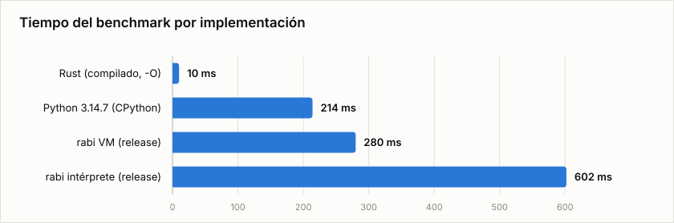

<p align="center">
  
</p>

<h1 align="center">rabi-lang</h1>

<p align="center">
  <em>Un lenguaje de programación básico implementado en Rust.</em>
</p>

<p align="center">
  
  
  
</p>

Este proyecto se desarrolló como Trabajo Práctico para la materia Lenguajes y Compiladores de la Facultad de Ingeniería de la Universidad de Buenos Aires.

##  Un vistazo al lenguaje

Bloques por indentación, tipado dinámico y sin punto y coma:

```python
# Comentarios con numeral
func fib(n):
    if n < 2:
        return n
    return fib(n - 1) + fib(n - 2)

let nombres = ["ada", "alan", "grace"]
for nombre in nombres:
    print "hola " + nombre

let i = 0
while i < 10:
    print fib(i)
    i = i + 1
```

La gramática completa está en [GRAMATICA.md](docs/GRAMATICA.md) y la semántica en [SEMANTICA.md](docs/SEMANTICA.md).

##  Instalación

Para instalar el proyecto se debe tener instalado [Rust y Cargo](https://www.rust-lang.org/tools/install).

Luego de clonar el repositorio, se puede instalar el proyecto ejecutando el siguiente comando en la raíz del proyecto:

```bash
make install
```

Todos los comandos del proyecto están en el `Makefile`. Para ver la lista completa:

```bash
make
```

##  Uso

```bash
rabi [ --backend interpreter | --backend vm ] [ --scanning | --parsing | --bytecode ] [ <archivo> ]
```

Si se provee un archivo, el programa lo ejecutará y mostrará el resultado en la salida estándar. Sin archivo, abre el modo interactivo (REPL) que conserva las variables y funciones entre entradas.

Sin instalar el binario, se puede correr un programa desde la raíz del proyecto con:

```bash
make run FILE=<archivo> [ ARGS="--backend vm" ]
```

### Intérprete y compilador

El parámetro `--backend` elige cómo se ejecuta el programa:

| Backend | Qué hace |
| --- | --- |
| `--backend interpreter` | Ejecuta con el intérprete (tree-walk interpreter). Valor por defecto. |
| `--backend vm` | Compila el programa a bytecode y lo ejecuta en una máquina virtual. |

### Etapas intermedias

Los parámetros de `scanning`, `parsing` y `bytecode` son mutuamente excluyentes. Si se provee alguno de ellos, el programa detendrá la ejecución en la etapa correspondiente y mostrará el resultado en la salida estándar. En ese caso `--backend` no tiene efecto.

| Etapa | Qué muestra |
| --- | --- |
| `--scanning` | Los tokens que produce el scanner. |
| `--parsing` | El AST que produce el parser, antes de optimizar. |
| `--bytecode` | El bytecode desensamblado (el mismo que ejecuta la VM), ya optimizado, con una sección por función. |

##  Ejemplos

En [`example/`](example/) hay dos programas escritos en rabi:

- [`example/brainfuck.rabi`](example/brainfuck.rabi): un intérprete de Brainfuck escrito enteramente en rabi.
- [`example/tateti.rabi`](example/tateti.rabi): un ta-te-ti por consola para dos jugadores, que usa la expresión `input`.

```bash
make run FILE=example/brainfuck.rabi
```

Las instrucciones completas están en el [README de los ejemplos](example/README.md).


##  Tests de integración
Se encuentran tests de integración en el directorio `tests/`. Para ejecutarlos, se puede usar el siguiente comando:

```bash
make test
```

Los tests corren los programas encontrados en `tests/test-programs/`, los cuales son equivalentes a los provistos por la cátedra, adaptados para el lenguaje `rabi`. Cada programa se ejecuta con los dos backends: `tests/interpreter.rs` usa el intérprete y `tests/vm.rs` usa el compilador y la VM. También se verifica que la salida sea la misma en las dos ejecuciones.

##  Benchmark
Se encuentra adjunto un benchmark. Se implementó un mismo programa en rabi, Python y Rust. Para correrlo y ver los tiempos de ejecución, se puede usar el siguiente comando:

```bash
make bench
```

Es requisito previo tener instalado Python 3 y Rust. El benchmark compila el programa en Rust y luego ejecuta los tres programas, mostrando los tiempos de ejecución. No verifica nada ni forma parte de la suite de tests: ni `make test` ni `cargo test` lo corren.



El detalle de cómo la VM llegó a ese número está en [OPTIMIZACIONES.md](docs/OPTIMIZACIONES.md).

## Entrega parcial - Intérprete

Leer [ENTREGA_PARCIAL.md](docs/ENTREGA_PARCIAL.md) para más información sobre la entrega parcial del proyecto.

## Entrega final - Compilador a bytecode y VM

Leer [ENTREGA_FINAL.md](docs/ENTREGA_FINAL.md) para más información sobre la entrega final del proyecto.


<p align="center">
  
</p>
