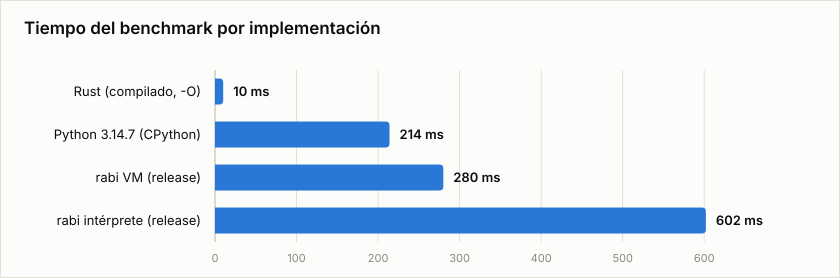
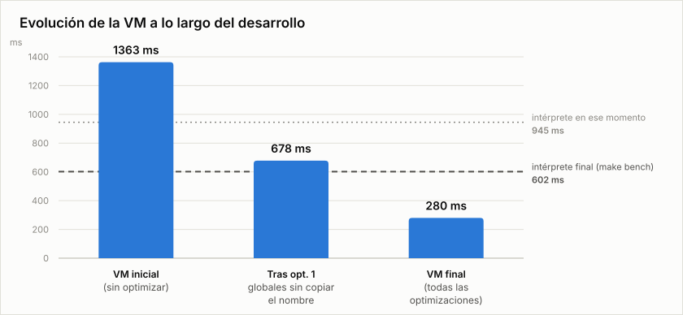

# Entrega Final TP Opción II - Lenguajes y Compiladores - 16/11/2026

<center>

| Patricio Ibar | pibar@fi.uba.ar |  109569 |
|---------------|:---------------:|--------:|

</center>

## Índice

- [Entrega Final TP Opción II - Lenguajes y Compiladores - 16/11/2026](#entrega-final-tp-opción-ii---lenguajes-y-compiladores---16112026)
  - [Índice](#índice)
  - [Introducción](#introducción)
  - [Documentación](#documentación)
  - [Compilador de bytecode](#compilador-de-bytecode)
    - [Detalles de implementación](#detalles-de-implementación)
      - [Bytecode como Enum de Rust](#bytecode-como-enum-de-rust)
      - [Cortocircuito y operaciones compuestas](#cortocircuito-y-operaciones-compuestas)
      - [`break` y `continue`](#break-y-continue)
      - [Valores compartidos entre intérprete y VM](#valores-compartidos-entre-intérprete-y-vm)
    - [Resultados de benchmarking](#resultados-de-benchmarking)
  - [Optimizaciones](#optimizaciones)
  - [Feature `input`](#feature-input)
  - [Caso de uso](#caso-de-uso)
    - [Un intérprete de Brainfuck escrito en rabi](#un-intérprete-de-brainfuck-escrito-en-rabi)
    - [Ta-te-ti](#ta-te-ti)
  - [Conclusión](#conclusión)
 

## Introducción

En esta entrega final se trabajó diferentes aspectos del trabajo practico, entre ellos:
- Documentación completa del lenguaje
- Una implementación del lenguaje con compilador a bytecode
- Optimizaciones
- Una nueva feature `input` para leer texto ingresado por el usuario
- Un caso de uso del lenguaje de programación

Con el compilador de bytecode, `rabi` pasó a tener **dos implementaciones del mismo lenguaje**: el intérprete de AST de la entrega parcial y la máquina virtual de esta entrega. Las dos comparten el scanner y el parser, y las dos responden a la misma especificación ([SEMANTICA.md](SEMANTICA.md)). Al ser ambos implementaciones del mismo lenguaje, un mismo programa debería tener el mismo comportamiento sea cual sea la implementación que lo ejecuta. Los tests de integración de la VM ([tests/vm.rs](../tests/vm.rs)) corren cada programa de prueba en los dos backends y exigen que la VM imprima exactamente lo mismo que el intérprete.

## Documentación
Se agregó documentación completa de la gramática y semántica del lenguaje de programación. La misma se encuentra en dos archivos:

- [GRAMATICA.md](GRAMATICA.md) Incluye una especificación EBNF completa de la gramática sintáctica del lenguaje, junto con algunas notas adicionales sobre la estructura léxica y otras cuestiones de sintaxis que podrían ser ambiguas de sólo poseer la especificación EBNF.
- [SEMANTICA.md](SEMANTICA.md) Explica de la manera más completa que pude la semántica del lenguaje. Intenté seguir el orden en que se ven los temas durante la cursada, y yendo al detalle en cuestiones que me resultaron interesantes y se solicitó explícitamente aclarar (como la resolución de scopes, y la ausencia de closures).

## Compilador de bytecode
Ahora al iniciar el programa se puede decidir que backend utilizar: intérprete o vm (bytecode). Más instrucciones en el [README principal](../README.md) 

### Detalles de implementación

#### Bytecode como Enum de Rust
Una de las primeras cuestiones que se presentaron al implementar el compilador fue el cómo representar el bytecode para la VM.

Tenía dos opciones principales:
- **Utilizar bytes crudos**: similar a como se hace en la implementación de la cátedra, simplemente se guardarían bytes en un array o vector y se llevaría registro de qué significa cada uno.
- **Utilizar un Enum de Rust**: una versión mas "rusty" aprovechando elementos del lenguaje de implementación, y en mi opinión mucho más cómodo para desarrollar y leer.

El tradeoff principal que tuve en cuenta fue el de simplicidad de implementación a cambio de performance. Supuse que la implementación con bytes crudos sería más eficiente, aunque cueste la claridad y comodidad de utilizar Enums. 

Sin embargo, realicé un pequeño POC utilizando herramientas de inteligencia artificial. Se implementó un pequeño lenguaje con VM y compilador, con una versión usando bytes crudos para el bytecode y otra utilizando un Enum. Para mi sorpresa resultó que la versión del Enum era ligeramente más eficiente en tiempo de ejecución (alrededor de un 10%). Con ese resultado me decanté por completo por la opción de los Enums y es así como terminé implementando el bytecode.

A continuación algunas ventajas y desventajas que encontré al usar el Enum durante la implementación:

**Ventajas**
- El compilador emite la operación junto con el operando (e.g. `Operation::GetLocal(i)`) en lugar de escribir el opcode y después los bytes del operando por separado. Esto facilitó tanto el emitir el código en el compilador como el ejecutarlo en la VM.
- Agregar una instrucción nueva es agregar una variante al Enum. Al hacer eso el compilador de Rust avisa en qué `match` falta manejarla, lo cual facilita mucho la adición de nuevo código (por ejemplo, una feature nueva como [`input`](#feature-input)).

**Desventajas**
- Al usar un Enum, todas las operaciones necesariamente son del mismo tamaño. Esto fue un factor a tener en cuenta al crear las operaciones del bytecode, ya que si en alguna operación utilizaba operandos de diferente tamaño, o diferente cantidad de operandos, afectaría el tamaño de todas las demás operaciones por más que sigan igual. Es por esto que todas las operaciones tienen como máximo un operando de 2 bytes. Así, cada operación ocupa 4 bytes (corroborado utilizando `size_of::<Operation>()`).

#### Valores compartidos entre intérprete y VM
El intérprete y la VM usan el mismo Enum `Value` para representar los valores del lenguaje. La única diferencia entre ambos es la representación de las funciones: en el intérprete una función guarda el AST de su cuerpo, y en la VM guarda su bytecode. Por eso `Value` es genérico sobre el tipo de función (`Value<F>`), y cada backend usa su propia versión.

De esta forma la aritmética, las comparaciones y las reglas de veracidad se implementan una sola vez, y los dos backends se comportan igual sin tener que mantener dos implementaciones en paralelo.

Esto tiene una contraparte en performance, la cual se comenta en [OPTIMIZACIONES.md](OPTIMIZACIONES.md#5-atajo-para-la-aritmética).

#### Operaciones compuestas y cortocircuito
El cortocircuito de `and` y `or` se implementa con saltos: se evalúa el operando izquierdo y, según su valor de verdad, se saltea el código del operando derecho sin evaluarlo.

Los dos operadores no devuelven lo mismo: `and` siempre devuelve un booleano, mientras que `or` devuelve el operando que decidió el resultado (más detalle en [SEMANTICA.md](SEMANTICA.md#operadores-lógicos-y-cortocircuito)). Un truco interesante que usé para que `and` devuelva un booleano, es que para lograrlo el compilador emite dos `Not` seguidos al final (como hacer `!!x`) que termina convirtiendo el resultado, cualquiera sea su tipo, en su equivalente booleano.

El hecho de convertir un valor a su equivalente booleano según si es *thruthy*, no es el único caso en que una operación del lenguaje se compila como dos instrucciones:
- No existe `JumpIfTrue`, así que `or` se compila con un `JumpIfFalse` seguido de un `Jump`: si el operando izquierdo es falsy se salta a evaluar el derecho, y si no, el `Jump` lo saltea.
- No existe `NotEqual`, así que `a != b` se compila como `Equal` seguido de `Not`.

Esto lo hice con la intención de mantener chico el set de instrucciones, lo que simplifica tanto el compilador como la VM, pero en contraparte hace que se tenga que ejecutar una instrucción de más en cada caso. Si se desease optimizar aún más la VM, podrían agregarse varias instrucciones combinadas que hagan el efecto de ejecutar varias juntas.

Otro factor interesante a mencionar es que como los saltos guardan la distancia en su operando de 2 bytes, un salto puede cubrir como máximo 65535 instrucciones. Esto limita el tamaño de los bloques de condicionales y bucles, aunque es difícil alcanzarlo en un programa real. En [SEMANTICA.md](SEMANTICA.md#bloques-e-indentación) se aclaré que el lenguaje deja abierto a la implementación el tamaño máximo de bloque.

#### `break` y `continue`
Un caso que me costó un poco implementar, sobre todo porque no había ejemplo en la implementación de la cátedra, fue el caso de `break` y `continue`. 

Para compilarlos el compilador lleva una pila con los bucles en los que s se encuentra (`for row in rows: for col in row: ...` tendrá una pila de 2 elementos), cada uno con una referencia al número de instrucción inicial, la  profundidad de scope, y una lista de los `break` emitidos.<br>
`continue` se compila como un salto con destino al inicio del bucle más interno.<br>
`break`, en cambio, salta al final del bucle, que todavía no se conoce cuando se emite el `break`, por lo que el salto se emite con un destino provisorio y se corrige al terminar de compilar el bucle. <br>
En ambos casos, antes de saltar se descartan de la pila las variables locales declaradas dentro del bucle.

### Resultados de benchmarking

Para comparar la VM con el intérprete se usó el mismo benchmark de la entrega parcial (en `/tests/benchmark`): un bucle de un millón de iteraciones que realiza operaciones con valores enteros, flotantes y strings, implementado en `rabi`, Python y Rust. El programa no cambió desde la entrega parcial.

Las mediciones se tomaron en la misma notebook que en la entrega parcial (Intel Core i3-1215U, 8 GB de RAM, Ubuntu 26.04 LTS, kernel 7.0, `rustc` 1.98.1). Al igual que antes, los tiempos son de proceso completo, por lo que incluyen el arranque de cada programa.

| Lenguaje | Promedio |
|----------|---------:|
| Rust (compilado, `-O`) | **10 ms** |
| Python 3.14.7 (CPython) | **214 ms** |
| `rabi` VM (release) | **280 ms** |
| `rabi` intérprete (release) | **602 ms** |



El benchmark también desglosa el tiempo de `rabi` por fase (no incluido en la tabla). El scanning, el parsing, la optimización y la compilación juntos tardan menos de 0,1 ms, así que prácticamente todo el tiempo se va en la ejecución.

Luego de las [optimizaciones](#optimizaciones), la VM resultó aproximadamente 2,15 veces más rápida que el intérprete. Sin embargo, antes de optimizarla era más lenta (ver [Conclusión](#conclusión)).

Comparada con CPython, la VM de `rabi` es aproximadamente 1,3 veces más lenta. Al ser las dos implementaciones de VMs de bytecode de diferentes lenguajes, esta comparación es mucho más significativa ahora que en la entrega parcial. Creo que hay dos cosas que notar que diferencian las dos implementaciones: 
1. Python es un lenguaje mucho más antiguo, optimizado, y trabajado que rabi. Se podrían seguir aplicando muchas optimizaciones y mejoras tanto al compilador como a la VM de rabi para mejorar su performance y, en mi opinión, podría ser más rápida que la de Python con relativamente poco esfuerzo (por ejemplo, implementando un resolver).
2. Python es un lenguaje **muchísimo** más extenso y complejo que rabi. Teniendo en cuenta eso, la comparación deja de ser tan justa para Python que tiene que manejar mucha más complejidad y proveer diferentes funciones.

En la entrega parcial se planteó la pregunta de si la versión compilada iba a tener un desempeño comparable al de un lenguaje compilado. La respuesta es (claramente) que no: Rust sigue siendo unas 28 veces más rápido que la VM. Esto es esperable, ya que `rabi` compila a bytecode que luego se interpreta en una VM implementada en Rust, mientras que Rust compila directamente a código máquina nativo y por lo tanto se ejecuta mucho más eficientemente.



## Optimizaciones
Inmediatamente después de terminar el compilador de bytecode, resultó ser mucho más lento que el intérprete implementado en la primera parte del TP. Debido a esto, le dediqué tiempo a aplicar optimizaciones a la VM. 

Luego, también implementé la optimización sobre el código generado Constant Folding. Esta optimización se implementó más por gusto y ganas de aprender cómo se aplican esas estrategias que por el hecho de optimizar código.

La estrategia seguida y más detalle de las optimizaciones realizadas se encuentran en [OPTIMIZACIONES.md](OPTIMIZACIONES.md)

## Feature `input`
Agregué una nueva expresión para obtener input de parte del usuario. La razón principal fue el hacer un programa interactivo para el caso de uso.

## Caso de uso

### Un intérprete de Brainfuck escrito en rabi

El caso de uso principal es un intérprete de Brainfuck escrito enteramente en rabi: [`example/brainfuck.rabi`](../example/brainfuck.rabi). 

Brainfuck s un lenguaje Turing-completo, así que si rabi puede ejecutar cualquier programa de Brainfuck, entonces se puede decir son equivalentes y por lo tanto se está demostrando que rabi también es Turing-completo. El intérprete implementa las ocho instrucciones del lenguaje (`>`, `<`, `+`, `-`, `.`, `,`, `[`, `]`) sobre una cinta de 30000 celdas de 8 bits, resuelve los corchetes antes de ejecutar y reporta los que están desbalanceados indicando la posición.

```
$ rabi example/brainfuck.rabi
Intérprete de Brainfuck en rabi

--- hola mundo (106 instrucciones) ---
Hello World!

--- eco de la entrada (17 instrucciones) ---
rabi
```

Me pareció gracioso hacer una implementación de un pequeño lenguaje usando mi propio lenguaje para demostrar que puede servir como herramienta de uso general, tanto para programar pequeños scripts como para herramientas un poco más complejas y útiles.

Al escribir este programa me topé principalmente con dos límites de rabi que no había notado:q

- **No se pueden indexar strings**, así que un string es un valor opaco y no hay forma de recorrerlo carácter por carácter. Por eso el programa de Brainfuck se representa como un array de strings de un carácter y no como un string. Esto supuso un problema principalmente porque provoca que el intérprete no pueda leer un programa desde la entrada estándar, ya que `input` devuelve un string que después no puede descomponer.
- **No hay secuencias de escape** (ver [Literales](GRAMATICA.md#literales)) y las comillas dobles son el único delimitador de strings, así que no existe forma de escribir el carácter `"` en un literal.

### Ta-te-ti

Como segundo ejemplo, más chico, dejé el ta-te-ti por consola para dos jugadores que escribí junto con la feature `input`. El programa está en [`example/tateti.rabi`](../example/tateti.rabi), y las instrucciones para correrlo y jugar en el [README del ejemplo](../example/README.md).

El juego dibuja el tablero, pide a cada jugador la casilla en la que quiere jugar (con `input`), valida la jugada, y detecta cuándo alguien gana o hay empate. Al terminar cada partida se muestra un marcador y se pregunta si se quiere jugar otra.

```
  X | 2 | O
 ---+---+---
  4 | X | 6
 ---+---+---
  O | 8 | 9

Turno de X. Elegí una casilla (1-9):
```

Lo elegí porque usa casi todo el lenguaje (funciones, arrays, bucles `for` y `while`, condicionales y variables globales) y porque me parece un buen primer programa "completo" para alguien que está aprendiendo a programar, que es el otro uso que le veo a rabi.

## Conclusión
Uno de los resultados que más me llamó la atención del trabajo fue que, al terminar la VM resultó ser 1,44 veces **más lenta** que el intérprete. Recién después de aplicar las optimizaciones pasó a ser unas 2 veces más rápida. A priori parecería que la mejora de performance no vino del cambio de método de implementación (intérprete a VM) sino de la aplicación de optimizaciones. Para mí esto tenía sentido, ya que al final del día ambos son programas escritos en el mismo lenguaje, que hacen prácticamente lo mismo de dos maneras diferentes. 

Sin embargo, también hay que tener en cuenta que esas "optimizaciones" fueron en su mayoría más bien correcciones de ineficiencias en la implementación (copiadoo de variables de forma innecesaria, cambiar a una función de hash más rápida). Por lo tanto, creo que se podría decir que la VM sí supone una ventaja en eficiencia sobre el intérprete, pero hay que implementar una buena VM para que realmente haya diferencia. 

Luego, al investigar un poco más sobre el tema en internet y en el libro de la cátedra, descubrí que en efecto es así: <br>
Por un lado, al representar el código de una forma más compacta y plana, que se recorre secuencialmente en lugar de recursivamente, se pueden aprovechar mejor las funciones optimizadas del CPU, como las diferentes tiers de caché (aunque obviamente nunca tanto como si estuviera compilado a código de máquina). <br>
También se abre ventana a muchas más optimizaciones que serían más difíciles de aplicar en un AST, como la utilización de instrucciones combinadas, o incluso la traducción directa a código de máquina usando estrategias como un Just In Time compiler.

Sobre el caso de uso, `rabi` sigue siendo un lenguaje muy pequeño y con pocas features, pero aún así tiene herramientas muy útiles (arrays, funciones, recursión) que alcanzan para escribir programas complejos, por ejemplo un programa que entiende y ejecuta programas escritos en otro lenguaje. Si bien podría argumentarse que siempre va a ser una mejor opción usar un lenguaje conocido y mantenido por un equipo profesional, creo que se le puede dar un buen uso a `rabi` para construir scripts y herramientas de software. <br>
Además de eso, creo que `rabi` podría tener un buen uso didáctico: tiene una sintaxis simple, parecida a Python, y una semántica completamente documentada y sin casos raros (por ejemplo, la ausencia de closures hace que lo que ve una función dependa solamente de sus parámetros, sus variables locales y las globales). Creo que podría ser un buen lenguaje para alguien que está aprendiendo a programar.
